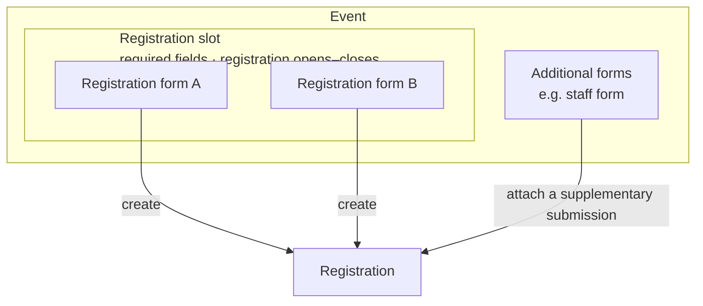

# Events and forms

## Events

- **The event is the top-level unit.** A form belongs to exactly one event,
  and the event is fixed by which form is opened. Seasons are grouped by
  dates, labels and filters, not by a layer above events.
- **Budgets and accounting are completely separate per event.** Linking
  events (e.g. REFISZ's two camps) is not part of the lifecycle.

## Event lifecycle

- **States are admin acts:** draft → published ⇄ unpublished → archived.
  - **Unpublished** pauses all of the event's public interfaces: forms, the
    portal, payments. It also stops the event's mail: no delivery is
    sent, and the periodic run adds no scheduled or reminder deliveries for
    it. Action mails are still queued, so none is forgotten.
    The portal is closed too, including "resend my link"; self-sent mails
    requested before unpublishing stay queued. On republishing, the admin sees the pending count and can clear them.
    This follows from a sound unpublish; the control stays separate from the global mail pause, which
    only pauses sending ([Mail](mail.md#pausing)).
  - **Archived** is read-only and starts the retention clock.
- **The "full" latch** is the other stored event state
  ([Registrations](registrations-and-identity.md#status-capacity-and-waitlist)).
- **A failed load treats every event as unpublished** without changing the
  stored state ([Modules](modules-and-extensions.md#failure-isolation)).
- **Timeline points:** core has **registration opens, registration closes,
  start, end**; admins can add their own named points, which mails can use.
  Points are **absolute dates only**, never relative to each other (that
  would allow cycles).
- **"Open", "closed" and phases are derived** by comparing the current time
  with the points. They are never stored, and nothing fires at those moments.
  The same holds for every form's date window. Registration therefore opens
  and closes automatically at its points; to change that, an admin edits the
  dates (which does not clear the "full" latch).
- **The participant phase tracker** (today's F1–F5) stays, as a modular
  subsystem in the Events module: core default phases, configurable,
  extensions add phases. Designed later ([Deferred](deferred.md)).
- Today's reclassification is dropped; late fees replace it. Post-camp
  settlement is a deferred extension.

## Date references

Wherever a date can be set (mail schedules, field locks, fee rules, …) it can
be:

- a fixed date;
- an event point (core or custom);
- a **date type** declared by core or an extension.

A date type **may differ per registration** (e.g. 14 days after registering or
a fixed date, whichever is earlier). It is computed only from registration
facts and absolute points, never from another derived date. Core declares
**payment due**: an anchor plus N days, with a cap, both configurable
([Money](money.md#core-money-scope)). Date types are an extension point that runs inside the
transaction and takes one immutable input; the periodic run computes them
in PHP for registrations in published events. If that ever becomes slow, the
computed date is cached in a column on the registration.

**A deadline ends at midnight in the site time zone** at the end of its day.

## Forms and the registration slot

- An event has a **registration slot** holding one or more forms, plus
  **additional forms** that attach extra data to an existing registration
  (e.g. a staff form). A form's purpose follows from where it sits.
- **Every form has its own access requirements,** kept minimal: a date window,
  a password (WordPress's own post password) and a required WordPress role.
- **The slot adds two rules:** every form in it must contain the required
  fields and functionality (e.g. exactly one contact email), and the slot's
  date range (registration opens and closes) applies on top of each form's own
  requirements. Otherwise all forms share the same primitives.
- **The event's capacity is the only capacity on registrations**
  ([Registrations](registrations-and-identity.md#status-capacity-and-waitlist)).
  There are no registration categories and no per-form capacity. Options of
  an assignment set have their own capacity, which limits only that choice.
- **Staff work as today:** they register through the normal registration form
  (taking a place), then fill in the staff form, an additional form whose
  answers give the discount. Staff is not a core concept; it is built on
  supplementary submissions.
- Workshops, modules, groups, rooms and meal turns are **assignment sets**
  ([Modules](modules-and-extensions.md#assignment-sets)). A choice field in a
  form writes a set's direct choice or a request; re-choosing later is an
  edit in the portal while the set's choice window is open, not a resubmitted
  form.
- **Form texts read amounts, quotas and deadlines from the event's settings,**
  so they cannot drift from the rules
  ([Values and conditions](#values-and-conditions)).

## Prefill from a link

- **There is no public prefill:** no URL argument other than the link token
  affects a form.
- **A form link prefills from its record** (below): the server sets the
  values, either locked or as editable prefilled values. Prefill from a
  preset is separate ([Fields](#fields)).
- **Form links created from public pages** (e.g. the module recommender, or
  "register for the other camp too") come from a portal or system use case
  with its own rate limit.

## Form links and admin submissions

**One form-link mechanism replaces the one-time invitation.**

- **A form link has:**
  - its form;
  - the field values it sets, each either locked (read-only or hidden) or an
    editable prefilled value;
  - uses: unlimited or at most N (a single-use link, max 1, is today's
    invitation); a use is spent on a successful submit, not on opening;
  - bypasses, each off by default: the form's requirements, the slot's date
    range, the event's capacity and "full" latch (an invitation has them all
    on, so the registration lands as `registered`);
  - an expiry, and revocation. Expired links are cleaned up.
- **Creation, revocation and use are audited.** The link a registration came
  through is stored on it as a fact.
- **Link-only fields** can be set only by a link, never by the registrant. **Link-only options** are choice options shown only when a
  link sets them (e.g. an invitation-only track or partner).
- **Secret sections** are ordinary conditional sections whose condition reads
  a link-only field. The server re-checks conditions at submit
  ([Conditions](#conditions)).
- **Tokens:** 128 random bits, never logged, masked in exports, sent with
  no-referrer. Links are stored readable, single-use ones included, so admins
  can always re-send them.
- **An association** (e.g. a partner church) is either chosen by the
  registrant from public options, or set and locked by a partner's link; the
  stored fact records which. A link-set association is not partner
  confirmation: that is a separate field, which a link may set secretly, or
  which the partner sets in its view.
- A late staff member gets one link for the registration form and, if needed,
  a second one for the staff form.
- **Admins can fill in any form themselves** regardless of its criteria; the
  audit records it.
- Form links complement password-protected forms.

## Forms implementation

- **Our own implementation on WordPress's building blocks; no form plugin.**
- Forms are **block documents** (`kalaka_form` posts) built from our own
  field blocks.
- The public page uses WordPress's **Interactivity API**.
- **Forms need JavaScript.** Conditional sections are hidden by default, and
  the form shows a warning when JavaScript is off (UI text approved when
  built).
- **The server validates against the same form definition:** only declared,
  visible fields are accepted.
- **Each submission stores the form and its version**
  ([Registrations](registrations-and-identity.md#submissions-and-values)).
- **Stable field keys** and pickers for conditions; an **embed block** for
  placing a form on any page.
- Still to build within forms: spam protection and file upload
  ([Deferred](deferred.md)).

## Fields

| Concept | What it is |
|---|---|
| **Field type** | Code: a block type from core or an extension. It defines the data shape, validation, editor and front-end UI, admin display and filtering. Core ships the basic shapes (name, email, phone, date, text, choice, …) |
| **Field definition** | Optional organization configuration in its own post type (`kalaka_field`), edited in the block editor and limited to one field block. Holds the complete field including its settings, with no override layer. Created by a single switch on a form field |
| **Form field** | A block in a form, standalone or copied from a definition (keeping the definition's ID and version) |

- **Definition, its copies in forms and its data are three separate things.**
  Changing a definition never changes forms automatically: admins are offered
  an update per form (a new form version), and registration data is never
  touched.
- **A definition never changes its type.** Presets store values in the type's
  shape; a different type means a new definition.
- **Prefill from a preset:** only fields linked to a definition are
  prefilled, because presets store values by definition ID. A copy edited after it was taken
  still prefills whenever the preset value is valid for the field's current
  settings (e.g. a removed choice option is not); otherwise it stays empty.
  How prefill looks is approved with the UI. Prefill from a link is
  separate ([Prefill from a link](#prefill-from-a-link)).
- **Types may refuse** to be definitions and may refuse prefill.
- **Hidden fields** hold values the registrant does not see, such as an
  attribution key. They get their values only from the form link record;
  values the browser sends for them are rejected.
- Extensions add field types, e.g. the congregation picker
  ([Money](money.md#sponsor-and-church-support)) and the module ranking.
- **Explicit markings:** the contact email (exactly one per form in the
  registration slot) and the display name.
- **Money-relevance is a type capability** supplied by plugins; core ships no
  money field types. Values are stored like any other, **locked after submit
  by default** (an organizer can unlock per field), and changed only through
  use cases that re-materialize the money.

### Editability after submit

- Each form field defines whether registrants may edit it after submit, with
  locks by date (a date reference) or set manually.
- Registrants (by secret link or owner account) see all their submitted data
  and can edit the editable fields.
- Organizers with the capability can correct any field at any time.
- The original submission stays unchanged, and every edit is audited.

## Values and conditions

**One value API** serves mails, portal pages and forms.

- **Each document kind declares its context,** and pickers offer only that
  context's keys:
  - mail: the recipient and the registration;
  - portal page: the logged-in person and their registration;
  - form: answers only, for conditions; event values are rendered at page
    load.
- **Whole attributes** use Block Bindings with one source, `kalaka/value`,
  with a `key` argument.
- **Inline values** are a rich-text format stored as
  `Label`. Editors insert one from a
  toolbar picker, and it shows as a chip. The server replaces it using the
  HTML API. The same span works in custom HTML.
- **Storage** is plain block markup in `post_content`. A friendlier editor
  later changes only the UI.
- **WordPress 7.0 was checked on 2026-10-31:** no core way to bind part of a
  text was found, since bindings replace whole attributes. Re-check at
  implementation, and use a core mechanism if one exists.

### Conditions

- **Container blocks** `kalaka/if`, `kalaka/else-if` and `kalaka/else` hold
  the branches, using the one condition format below.
- **The server renders them** in mails and portal pages.
- **Forms show and hide branches** with the Interactivity API. The server
  re-checks them at submit and keeps only answers whose conditions hold.

**The condition format:**

- **Operators:** equals, less than, less or equal, greater than, greater or
  equal, contains, empty.
- **A "not" switch** on each condition, instead of separate negated
  operators.
- **Typed comparison:** values compare as number, date, text or choice.
- **Combining:** all / any; a condition can be a group, one level deep.
- **Extension conditions** can be used alongside comparisons.
- Examples: status equals waitlisted; balance greater than 0; a multi-choice
  answer contains X; date of birth less or equal to a date.
