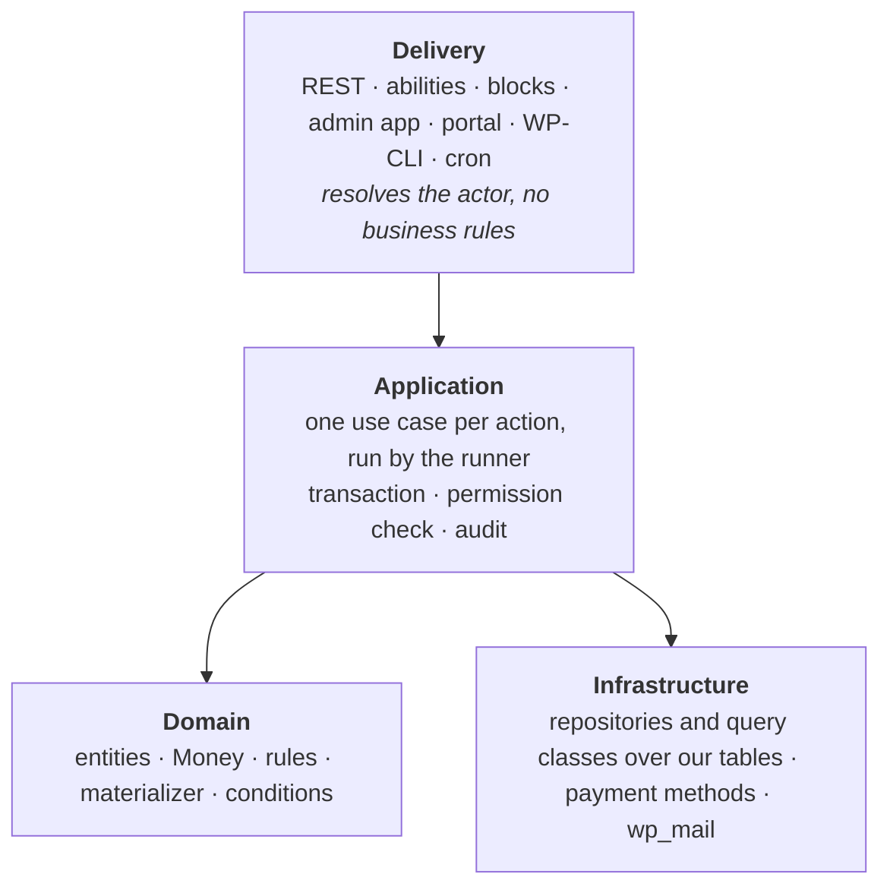
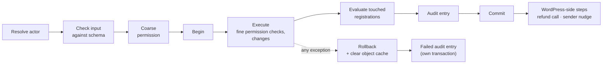

# Foundation

How every write happens, how failures are kept, and the rules that cut across
all modules.

## Layers

Every plugin we ship has the same layers. Dependencies point downward only.



1. **Domain code may use WordPress** where that makes sense. There is no
   "pure domain" rule: this is a WordPress plugin and need not be portable.
2. **An interface exists only where there really are several
   implementations** (payment methods, the clock). There is no general
   "infrastructure is swappable" layer.
3. **Use cases are the only entry point for writes.** REST controllers,
   abilities, WP-CLI commands, the periodic run and form submissions all call
   a use case. Nothing writes a table directly.
4. **Module and plugin boundaries are checked in CI**
   ([Engineering](engineering.md#static-checks)), not left to discipline.

## Two sides, one machinery

- **Admin side:** the actor is a WordPress user, WP-CLI or the system. A
  user reaches registration data through the views granted to them
  ([Views and grants](#views-and-grants)).
- **Portal side:** the actor is access to a registration. A secret link
  grants that one registration; an account grants every registration it
  owns, plus account-level actions (the combined list, paying all at once,
  presets). See [Registrations](registrations-and-identity.md#access).

Both sides use the same use-case runner (transaction, evaluation, audit,
errors) but have **separate action catalogues, authorization and
REST namespaces** (`kalaka-admin/v1`, `kalaka-portal/v1`). Use cases never
read the current user themselves: the delivery layer resolves the actor once
and passes it in.

## Views and grants

Organizers, module leaders and outside partners (e.g. a church body confirming
its own people) are all admin-side users. **The view defines which data can be
reached; the grant defines who holds the view.**

- **A view** belongs to one event: a row filter plus a column set, each column
  read or read-write. It is the only place where permissions on data are
  defined.
  - The master grid is a view with every column and no filter. A read-only
    variant is simply another view.
  - Admins define subset views; extensions define special-case views and
    contribute columns and filterable facts.
  - Filters and sorts use only stored facts and decisions
    ([Facts and decisions](#facts-decisions-and-computed-values)), so they
    stay per-event indexed queries under the `EXPLAIN` test. A tree or map
    lookup is expanded in SQL ("congregation in the descendants of X", "lunch
    option in the mapped options"). PHP computes only display and export
    columns.
  - A filter may take **one parameter bound at grant time** (e.g. "program
    roster, program = ?"), so twelve module leaders need one view.
  - View definitions are copied to the next event, optionally with their
    grants.
- **A grant** is (WordPress user, event, view, optional bound value, set of
  actions). A user may hold several grants for the same event. There are no
  grants across all events. Grants and changes to a view's columns or filter
  are audited.
- **A grant never lists registrations.** It covers whatever the view's filter
  matches when access is checked, so the set grows and shrinks as
  registrations come and change.
- **Full access** is one separate site-wide capability: every view, every
  column read-write, every action, every event including future ones. It is
  for the people running the system.
- **Actions that are not a column** (withdraw, remove, admit, record payment,
  refund, regenerate link, notes, audit history) are carried by the grant,
  not by WordPress roles. An action is usable only on registrations inside
  the filter of the same grant's view. Modules declare the actions they
  offer ([Modules](modules-and-extensions.md#the-module-interface)).
- Core ships a **minimal WordPress role** that only opens the Kaláka admin
  app, for outside grantees.
- **Enforced in one place:** on the admin side, registration data is read
  only through the view query (grids, detail page, export, search) or through
  full access, checked in CI like module boundaries. A use case changes a
  field only if it is a read-write column of a view the user holds, for a
  registration inside that view's filter.

## The use-case runner



- **One transaction per use case.** The audit entry is written in the same
  transaction as the changes, so neither exists without the other. The
  [evaluation](#evaluation) of the touched registrations runs in it too,
  before the audit entry.
- **Any database error rolls back the whole use case;** code never continues
  after catching one. (This also matches how SQLite aborts a transaction on a
  failed statement.) A rollback also clears the per-request object cache.
- **Retries:** only errors marked retryable (a reference-code collision, a
  deadlock, a version conflict hit by a system run) are retried, about three
  times, each attempt from scratch.
- **Nested use cases** join the outer transaction and write their own audit
  entry, linked to the parent. Effects are released after the outermost
  commit.
- **Inside a transaction only our own tables are written:** no WordPress
  functions that fire hooks or fill WordPress caches.
- **WordPress-owned data is changed before or after our transaction, never
  inside it,** ordered so that a failure leaves a harmless state:
  - Creating a WordPress account, when the person opts in on the form, runs
    *before* the transaction. If the registration then fails, the account
    simply exists, as after a plain sign-up. The set-password mail that
    activates it is queued by the registration itself
    ([Registrations](registrations-and-identity.md#accounts-on-the-registration-form)).
  - Steps *after* commit run in the same request and must be safe to repeat.
    A failure is kept on the record it concerns (see [Failures](#failures)).
  - The admin-started WooCommerce refund follows this pattern
    ([Money](money.md#refunds)).
- **The shapes** (in `Kalaka\Foundation\Api\UseCase`; actors in
  `Api\Actor`, errors in `Api\Error`):

  ```php
  interface UseCase {
      public static function name(): string;   // 'kalaka/withdraw-registration'
      public function inputSchema(): array;    // JSON Schema, WordPress REST/abilities dialect
      public function execute(array $input, Context $context): mixed;
  }
  interface AdminUseCase extends UseCase {
      public function action(): ?string;             // per-event action; null for a field change only
      public function event(array $input): ?int;     // null for site-level use cases
      public function targets(array $input): array;  // list<RegistrationKey> this call acts on
  }
  interface PortalUseCase extends UseCase { public function registrations(array $input): array; }

  Runner::run(UseCase $useCase, array $input, Actor $actor): mixed
  ```

  - Input is an array checked with WordPress's
    `rest_validate_value_from_schema`, so one schema serves REST, abilities
    and the runner.
  - **The coarse permission check on the admin side:** full access passes.
    Otherwise the user needs a grant for the event that carries the action
    (any grant for a field change), and every target must be inside that
    grant's view filter as it is now. A site-level use case (events, site
    settings, views and grants) needs full access. `SystemActor` and
    `CliActor` without `--user` have full access; with `--user` the CLI is
    checked as that user.
  - **The fine check** runs inside `execute`: a field change needs a
    read-write column of a held view whose filter contains the registration.
  - On the portal side the coarse check is access to the registrations the
    input names.
  - `Context` is what a running use case gets: `actor()`, `now()`, `run()`
    for a nested use case, and `afterCommit()` for WordPress-side steps.
  - **Actors:** admin side `UserActor`, `CliActor` (optional `--user`),
    `SystemActor`; portal side `SecretLinkActor` (the registration key, never
    the secret) and `AccountActor`.
- **No domain events in the initial shape.** Everything our own plugins do in
  response to a change must be consistent with it, so it happens inside the
  use case. Public after-save actions for third parties come later
  ([Modules and extensions](modules-and-extensions.md#after-save-actions)).

### Lock order

Every use case takes its locks in one order, so two transactions never wait
on each other in a circle:

1. the event row;
2. quota rows (price tiers and support offers), by key;
3. registration rows, by (event, code);
4. everything else.

- **A use case that touches several registrations locks them all first,**
  before it changes any of them.
- **The registration row is locked `FOR UPDATE` before its payments are
  read,** so the evaluation never decides on payments that change under it.

## Errors

- Use cases throw exceptions; the throw triggers the rollback.
- An exception carries a `WP_Error` (code, Hungarian message, HTTP status), so
  REST, abilities and WP-CLI show it correctly.
- Each exception class has its own default Hungarian text, and the place that
  throws can add Hungarian context. There is no result type and no separate
  code-to-text mapping.
- **The classes:** an abstract `KalakaException` (with `toWpError()`,
  `status()`, `isRetryable()`, `isAudited()`; the constructor takes optional
  Hungarian context) and, to start with:

  | Class | Status | Default text |
  |---|---|---|
  | `InvalidInput` (not audited) | 400 | Hibás vagy hiányzó adat. |
  | `PermissionDenied` | 403 | Ehhez nincs jogosultságod. |
  | `NotFound` | 404 | A keresett elem nem található. |
  | `VersionConflict` | 409 | Valaki időközben módosította ezeket az adatokat. Töltsd újra az oldalt, és próbáld újra. |
  | `RuleViolation` | 422 | A művelet nem hajtható végre. |
  | `SystemFailure` | 500 | Váratlan hiba történt. Próbáld újra később. |
  | `RetryableFailure` (a `SystemFailure`, retried) | 500 | as `SystemFailure` |

- **The UI addresses everyone with tegezés,** in the admin and the portal.

## Entities, repositories and queries

- **Entities** are plain objects that carry their own key. A reference to
  another record holds that record's key; a helper method loads it through a
  per-request object cache when needed. The loaded object lives only in the
  caller's variable: it is never stored on the entity or serialized.
- **Repositories** offer:
  - `find(key)`, which returns null when missing (the caller decides whether
    that is an error; there is no get/find split);
  - `upsert()` for entities;
  - `insert()` for append-only records (ledger lines, submissions).
- **Concurrent edits:** mutable records (registrations, events) carry a
  `version` column, and `upsert()` writes only if the version has not changed.
  An edit screen sends back the version it showed; if the record changed in
  the meantime, the user gets a conflict error (audited). A system run that
  hits a conflict retries from scratch. One mechanism covers both stale edit
  screens and races inside a request.
- **Change tracking for the audit:** the repository keeps a copy of each
  record as loaded and, on save, compares the record with it to build the
  audit diff. Entities stay plain, and a forgotten setter cannot drop a
  change from the audit.
- **Query classes** serve lists and the evaluation runs; they are built on
  indexes, not on repositories. **No N+1:** a list loads each related record
  type in one query, enforced by the query classes.
- **Per-event cost:** every table holding per-event data has indexes that
  start with the event ID, and every per-event list, sort and search query
  filters by event first. A database integration test seeds many events and
  checks each per-event query's plan (`EXPLAIN`); a query that examines rows
  outside its own event fails the build.

## Audit

- **One row per use case** in `kalaka_audit_entries`:
  - time (UTC);
  - correlation ID (per request or WP-CLI command);
  - parent ID (nested use cases);
  - side and actor;
  - action name;
  - IP address and user agent;
  - optional reason;
  - outcome (succeeded or failed) and, when failed, the error;
  - the changes as JSON: changed fields only, before and after, secrets
    masked.
- **`kalaka_audit_subjects`** lists every record a use case touched, so a
  record's history is an indexed query. A subject is identified by **record
  type, event ID and key**: e.g. (registration, 12, `47K3`) or (preset, empty,
  381). The event column is empty for records that do not belong to an event;
  it keeps "everything touched in event 12" a per-event indexed query.
- **Failed use cases are audited too.** After the rollback, the runner writes
  the entry in its own transaction (the main one is gone) with the outcome
  "failed", the action, actor, error and any known record keys, but **no
  changes and no input values**: input may hold personal data that a privacy
  erase could not later find. If even that write fails, PHP's error log is
  the fallback.
- **What is audited:** permission refusals, edit conflicts, rule violations
  and system errors. Plain validation failures (a missing or malformed answer,
  shown to the person at once) are not.
- **Privacy:** IP address and user agent are declared through WordPress's
  privacy tools; a privacy erase also scrubs audit diffs. Our own audit trail
  and notes replace WordPress revisions and comments for our data.

## Failures

**Failures are kept on the record they concern; there is no log table.**

- A mail delivery keeps its status and latest error.
- A refund request keeps its status and error.
- A registration the periodic run cannot evaluate gets an **"evaluation
  failed" flag** naming the rule that failed and its error
  ([Evaluation](#evaluation)). Admins see it as a broken record; the next
  successful evaluation clears it.
- A failing extension contribution is kept on its extension
  ([Modules and extensions](modules-and-extensions.md#failure-isolation)).
- Interactive failures are shown to the person at once. PHP's error log is
  the last fallback.

## Deferred work

**There is no job queue** (no Action Scheduler, no general queue). Each kind
of deferred work gets exactly the guarantee it needs:

- **Money converges.** The materializer writes only the difference between
  target and recorded, so it can run any number of times
  ([Money](money.md#materializer)). Changes caused by an action are
  materialized by the [evaluation](#evaluation) inside that action's
  transaction; changes caused by time passing (e.g. a late fee from an
  extension) are applied by the periodic run.
- **Mail is sent at most once.** Deciding a mail is due inserts a delivery
  with a unique key; only the sender run sends, never an interactive request
  ([Mail](mail.md#sending)).
- **The periodic run** comes **every 5 minutes**, matching today's Google
  Sheets system. It evaluates only work that has fallen due over time (late
  fees, scheduled mails, reminders) and retries registrations flagged
  "evaluation failed", then runs the sender. An admin or WP-CLI can also start
  it at any time; this is safe because every effect is claim-guarded.
- **Keeping the 5-minute run cheap:** it sweeps only published, non-archived
  events, and time rules query only what became due since the last run.
- **A real system cron is required,** with WP-Cron as the fallback.
  WordPress core has only WP-Cron, which fires only when `wp-cron.php` runs.
  - A warning shows when the last run is older than about 15 minutes (text
    approved when built).
  - A lock keeps two runs from overlapping.
- **No wake-ups per due time.** With a real cron every 5 minutes, or
  visitor-driven WP-Cron, per-time wake-ups would gain nothing over the
  5-minute run; they would need a "next due" method on every date-bearing
  extension and a recompute on every date change. Precision is set by what
  drives the cron.

### Evaluation

**The evaluation is one core procedure, not an extension point.** It brings a
registration's decisions, money and mail up to date with its facts.

- **When it runs:**
  - Repositories mark the registrations a use case writes to as touched. The
    runner evaluates each touched registration once, at the outermost use
    case, inside its transaction, before the audit entry.
  - The periodic run does the same for work that falls due over time, one
    transaction per registration.
  - Opening a registration in the portal or admin never evaluates it: a page
    view writes nothing.
- **Three phases, in order:**
  1. **decisions** ([Facts, decisions and computed
     values](#facts-decisions-and-computed-values));
  2. **money:** fee targets and the materializer
     ([Money](money.md#materializer));
  3. **mail decisions** ([Mail](mail.md)).

  Money and mail read facts plus the decisions recorded in the same pass.
- **Writes happen only on change:** a new transition, a non-zero difference,
  or a new delivery key.
- **Locks** follow the [lock order](#lock-order).
- **Failure:** any rule failure rolls back the whole use case, or, in the
  periodic run, just that registration. The run then sets the "evaluation
  failed" flag ([Failures](#failures)) in a small transaction of its own,
  naming the rule, and moves on to the next registration.

## Facts, decisions and computed values

**Every piece of registration state is one of three kinds.** Views filter and
sort on the first two ([Views and grants](#views-and-grants)).

- **Facts** come from people's acts: answers, payments (with their value
  date), the manual confirmation flag (with its set time), assignments,
  status, the "full" latch and "not counted". They are ordinary audited
  writes.
- **Decisions** are made by the system: confirmation in core
  ([Money](money.md#confirmation)), and the late fee, price-tier place and
  support place from extensions ([Money](money.md#quota-places)).
  - **Each decision is an append-only transition record** with kind, state,
    effective time, recorded time, cause (record type, event and key) and
    actor. The current state is the latest record.
  - The records live in their own table, indexed by event first.
  - **A decision is never recomputed;** only a named transition changes it.
  - Extensions contribute transition rules through a decision point, and core
    writes the records
    ([Modules](modules-and-extensions.md#the-extension-surface)).
- **Computed values are never stored:** balance, tallies, a congregation's
  ancestors, a meal turn from the option map, the sorszám.
- **Reading order:** core decisions are made first, then extension decisions.
  A decision reads facts and earlier decisions only. An extension decision
  reads facts and core decisions, never another extension's decision.
- **No decision, condition or view depends on deliveries.** Only the sender
  and the staff screens that list deliveries read them ([Mail](mail.md)).

## Bulk changes

**A bulk change is never blocked by one broken record:**

- one transaction per item;
- a result report linking to each failed record, with options to retry or
  skip it;
- a preview that surfaces problems first, where one exists (e.g. re-price).

Because registrations keep their tariff snapshot, saving event settings never
touches existing registrations ([Money](money.md#tariff-snapshot-and-re-price)).

## Cross-cutting rules

| Concern | Rule |
|---|---|
| **Storage** | Our own database tables for the domain (events, registrations, values, submissions, presets, ledger, deliveries, audit, notes, …). WordPress posts only for documents edited in the block editor: forms, field definitions, mail bodies |
| **Time** | Stored in UTC; displayed and computed in the site's WordPress time zone, never a fixed zone. A deadline ends at midnight in the site's time zone. Our own `Clock` interface (`now(): DateTimeImmutable`, the shape of PSR-20, which a bundled and prefixed `psr/clock` would no longer share anyway) wraps `current_datetime()` in production and is fixed in tests; WordPress has no clock abstraction of its own. Dates are set through date references ([Events](events-and-forms.md#date-references)) |
| **Permissions** | Data access through views and grants per event; one site-wide full-access capability; other actions are carried by the grant, usable inside that grant's view ([Views and grants](#views-and-grants)). Core ships a minimal role for outside grantees; the list of actions and their default bundles are defined with the owner later ([Deferred](deferred.md)). Admin actions are also WordPress abilities and use the same checks |
| **Personal data** | Kept only in our tables. WordPress privacy export and erase cover registrations, presets and audit diffs. Retention for guest data and the audit is decided later ([Deferred](deferred.md)); archiving an event starts its retention clock |
| **Secret links** | Treated as secrets: never logged, masked in exports ([Registrations](registrations-and-identity.md#access)) |
| **Money** | `DECIMAL(26,8)`, a currency code on every record, brick/math arithmetic, never floats ([Money](money.md#amounts)) |
| **Sorting** | `utf8mb4_hungarian_ci` on our text columns ([Engineering](engineering.md#database)) |
| **Language** | Hungarian UI strings directly in code; English identifiers and comments |
