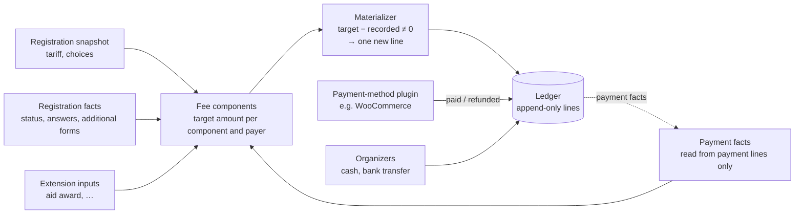
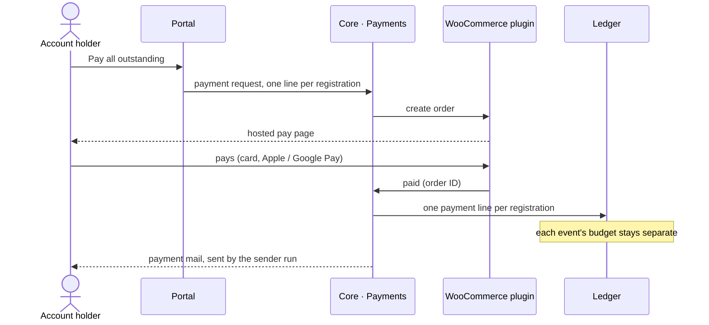

# Money

## Core money scope

- **Core:** a fixed price per registration and full payment, with its
  **payment due** date type. Core ships no money field types.
- **Payment due** is an anchor date plus N days, capped at a latest date; N
  and the cap are configured per event (IVK: 7 days).
- **Plugins:** deposits, payment rungs (the price ladder, with its tier
  quotas), late fees, financial aid, sponsor or church support, the
  congregation share and the wallet. Core keeps full support for extending it
  in these ways through typed extension points
  ([Modules](modules-and-extensions.md#the-extension-surface)).
- **Financial aid is two separate extensions:**
  1. adjudicated aid (the organizations call it a scholarship): the
     participant states what they can pay, organizers decide whether and how
     much to grant, and payment is blocked until decided. It reduces only the
     participant's own part. Every request with a positive amount waits for a
     decision; automatic evaluation may come later;
  2. sponsor or church support: offers on an organization directory
     ([Sponsor and church support](#sponsor-and-church-support)).
- Price-ladder tier quotas are separate from the event's waitlist. Each
  tier's quota is configured once, and texts render from it. Places in
  tier and support quotas follow [Quota places](#quota-places).
- **WooCommerce stays the payment engine** for online payment, through our
  own extension plugin ([Payments](#payments)). Without a payment plugin,
  online payment is unavailable, and organizer-recorded payments still work.

## Amounts

- **WooCommerce-compatible shapes:** every monetary record carries a currency
  code (ISO 4217). Multi-currency is possible but not built.
- **Stored as `DECIMAL(26,8)`,** like WooCommerce's order tables.
- **Payment requests are rounded up** to the currency's payable unit (whole
  forints for HUF).
- **Below one fillér counts as zero** in every outstanding check: the
  confirmation threshold, "nothing due" and fully paid.
- Rounding follows WooCommerce's own method if it has one; this is checked at
  implementation.
- **Arithmetic uses brick/math, never floats** (it uses bcmath or GMP when
  present, pure PHP otherwise).
- SQLite stores `DECIMAL` inexactly; that is accepted. Tests that fail on
  SQLite for this reason are fixed in the tests, not by changing the type, and
  no SQLite number formats are normalized.

## Ledger

- **One ledger per registration,** so per participant and event. Budgets and
  accounting are separate per event by construction.
- **Every line has a payer.** The default is the participant; extensions
  register other payer kinds (the congregation share registers
  "congregation"). Each payer has its own balance, and the registration's
  total is the sum of all lines.
- **Sign convention:** a positive amount increases what the payer owes; a
  negative amount decreases it. A balance is the sum of lines; above zero is
  due, below zero is overpaid.
- **Lines are append-only.** Every change is a new, explained line with a
  source reference and an idempotency key.
- **Ledger lines and decision records survive erasure**
  ([Registrations](registrations-and-identity.md#attribution-and-erasure)).

| Kind | Sign | Written by |
|---|---|---|
| `charge`, per fee component (the fixed price; plugin components such as a late fee or a staff discount) | ± | the materializer |
| `payment` (online or another automatic method) | − | Payments, from payment-method events |
| `refund` | + | Payments, from payment-method events |
| `manual_payment` (bank transfer, cash, card terminal) | − | the "record payment" use case |
| `manual_refund` (money returned by transfer or cash) | + | the "record refund" use case |
| `transfer` (a payment moved to another registration of the same event) | ± | the "move payment" use case |
| `adjustment` (correction with a reason) | ± | an admin use case |
| feature lines (aid award, sponsor support, wallet, …) | ± | feature plugins, through an extension point |

## Recording payments by hand

- **One "record payment" use case** serves the bookkeeper and the
  registration desk. One action records **one registration, one payer and one
  amount**, with the method, the value date and an optional bank reference or
  payer note (free text). It writes one `manual_payment` line.
- **"Record refund"** writes a `manual_refund` line for money returned by
  transfer or cash. WooCommerce refunds keep their own path
  ([Refunds](#refunds)).
- **A short transfer** (e.g. a foreign bank's deduction) is recorded as it
  arrived; the rest stays due until waived with an `adjustment` and a reason.
- **An unnamed transfer** is found through a view (name, code, amount) and
  recorded there. Core has no holding area for unassigned money.
- **Invoicing is by hand.** Kaláka offers views that show the bookkeeper what
  to copy into the invoicing service. Automatic invoicing, if ever, is our own
  integration, not WooCommerce's.

## Confirmation

- **Confirmation is a core decision**
  ([Foundation](foundation.md#facts-decisions-and-computed-values)), defined
  only for `registered` registrations. The evaluation writes its transition
  records; nobody sets it directly. It is not a status
  ([Registrations](registrations-and-identity.md#status-capacity-and-waitlist)).
- **The threshold** is a target per payer. Each payer with something owed must
  reach its own target. In core the target is the full amount; the deposit
  extension lowers it to the deposit through a typed point. The threshold is
  kept in the [tariff snapshot](#tariff-snapshot-and-re-price). Confirmation
  reads payment facts, never charge lines.
- **"The congregation part is required for confirmation"** is a per-event
  switch, on by default. Off, only the participant's target counts.
- **The manual flag** ("may come without paying") is a fact: set with a
  reason, audited, carrying its own set time, and kept until staff revoke it.

| Transition | When |
|---|---|
| → confirmed | payments reach the threshold, the manual flag is set, or nothing is due at the moment of the check |
| → unconfirmed | a refund takes payments below the threshold, unless the manual flag is set |
| → unconfirmed | the manual flag is revoked while payments are below the threshold |

- **Effective time:** each record carries one. It is the value date of the
  payment that reached the last required target (the paid time for online
  payments), or the set time of the manual flag.
- **A later charge or a higher threshold changes nothing:** the registration
  stays confirmed. A lower threshold can confirm more registrations at the
  next evaluation.
- **Withdrawal or removal closes the sequence.** Restore or admission writes a
  new record if the registration qualifies; the old one is never revived.
- **Deposit payment request:** max(0, threshold − payments so far), capped at
  the remaining balance. Waitlisted registrations get none.

## Late fee

An extension decision
([Foundation](foundation.md#facts-decisions-and-computed-values)). It looks
only at the participant's side.

- **Assessed** when the payment deadline passes and no payment dated before it
  (by value date, or paid time online) brought the participant's side to its
  target, and no manual flag was set before it. The materializer writes the
  charge.
- **Withdrawn** ("withdrawn" transition) when a payment recorded later turns
  out to have a value date before the deadline, for example a bank transfer
  entered days later. The
  materializer reverses the charge. There is no grace-period setting.
- **A manual flag set after the deadline** does not remove the fee; admins who
  want to drop it revert the charge with a line.
- **Charged only on tiers that have it enabled** (a per-tier setting). At
  REFISZ the normal and discounted tiers pay it; higher tiers have paid it in
  advance. It is never charged on staff registrations.

## Quota places

Tier places of the price ladder and support-offer places are extension
decisions ([Foundation](foundation.md#facts-decisions-and-computed-values)).

- **Held** when the registration becomes `registered` (at submit, admission or
  restore), decided under a `FOR UPDATE` lock on the tier or offer row.
  Waitlisted registrations hold no place.
- **Released** on withdrawal or removal.
- **Reassigned only by a staff act:** staff give a freed place to a requester
  from a list in registration order, so nobody's money changes
  automatically.
- **A restored registration** gets a place only if one is free.

## Withdrawal, removal and substitution

- **Retention applies per payer:** on withdrawal or removal (treated the
  same), each payer's fee target becomes min(that payer's own payments, its
  part of the retained amount), reading payment facts only, so nobody owes
  more after leaving. Core offers "retain nothing" and "retain everything
  paid"; the deposit extension adds "retain up to the deposit", which counts
  against the participant first. A surplus shows as an overpayment; refunds
  are never automatic.
- **Move payment** (a substitute takes someone's place): one organizer use
  case, **within one event only**, writes a pair of `transfer` lines with a
  shared reference (+amount on A, −amount on B), at most A's payer's net
  payments: payments, minus refunds, minus earlier moves out.
  Only payments move; B's charges and support come from B's own facts. Staff
  choose the target payer, and a remaining difference is an ordinary balance.
- Money moves between events only through the wallet's carry-over
  ([Deferred](deferred.md)).

## Congregation share

An extension: the registrant's congregation pays part or all of the **base
price**, never extras such as lunch or a donation.

- The share is the amount the registrant declares. A fee component writes a
  zero-sum pair, participant −X′ and congregation +X′, where
  X′ = max(0, min(declared share, base price − support)). Support thus reduces
  the participant's part first, and the congregation's only below zero.
- It reads facts only: the declared share, the support amount and the base
  price from the tariff snapshot.
- The congregation's payments carry the congregation payer, so its
  overpayment never settles the participant's extras.
- Whether the congregation's part is needed for confirmation is a per-event
  switch ([Confirmation](#confirmation)); a manual confirmation covers a late
  payer.

## Sponsor and church support

- **An organization directory,** site-wide: a tree of typed nodes whose root
  is the encompassing body (e.g. denomination → church district → deanery →
  congregation; a body without levels is a root on its own). Nodes have an
  external ID, aliases and an active flag; they are imported from CSV,
  deactivated and never deleted. No data is shipped.
- **A congregation field type** stores a node ID. The registrant searches for
  the congregation directly, which fills in the levels above it, or goes down
  from the top through filtered options, each level with a search. "Not in the
  list" is free text that staff map later.
- **A node's ancestors are looked up in the tree;** a filter on any level
  expands to its descendants in SQL.
- **Support offers per event on any node,** the root included, apply to the
  node and everything below it: amount, quota (people and/or budget),
  conditions on facts, "must be requested", and "must be confirmed by the
  body" (in its view or through a form link).
- **Stacking:** one flag per offer, "withdrawn if a lower-level support
  applies", on by default (the most specific wins); off, it adds to the lower
  one. Offers are evaluated from the congregation upwards, and a higher offer
  takes a quota place ([Quota places](#quota-places)) only if it ends up
  applying.
- **Each applying offer is one participant-side feature line,** labelled with
  its granting node.
- **Support is capped at the base price,** all applying offers together, so
  the fee never goes negative and support never pays for extras such as
  lunch.
- **Bodies pay in lump sums after the event,** against a report that groups
  support lines by granting node. It is a view, not a payer, and is separate
  from the congregation share.

## Tariff snapshot and re-price

- **Each registration keeps the tariff snapshot** it registered under: the
  price and the confirmation threshold.
- **Personal facts still recompute automatically:** e.g. a price-ladder
  choice, aid, staff status (a fact from an additional form), a passed
  deadline.
- **Event configuration edits reach existing registrations only through an
  explicit re-price** action with a preview. It replaces the snapshot, and the
  materializer writes the difference as `charge` lines; `adjustment` lines
  stay for manual corrections with a reason. Saving event settings never
  touches existing registrations.

## Materializer

- **It converges:** it writes only the difference between target and
  recorded, per component and payer, so it can run any number of times, with
  line idempotency keys.
- **Changes caused by an action** are materialized by the evaluation inside
  that action ([Foundation](foundation.md#evaluation)). **Changes caused by
  time passing** (e.g. a late fee) are applied by the periodic run, one
  transaction per registration, under a per-registration lock.
- **It reconciles only the fee components registered now,** and leaves lines
  of unknown components untouched.
- **Rules never read charge lines,** only payment facts. That avoids a
  feedback loop.

## Payments

- **Payments is a port in core.** Core defines what it needs from a payment
  method:
  - create a payment request for N registration lines, each for one payer's
    balance;
  - return the pay URL;
  - reuse an open request;
  - report paid, refunded and failed.
- **Payment methods are pluggable,** so more automatic methods (another
  gateway, bank-statement import, …) can be added without changing core.
  Cash and bank transfers are recorded by organizers in core
  ([Recording payments by hand](#recording-payments-by-hand)); WooCommerce
  uses no offline gateway.
- **Online payment covers the participant's lines only,** including an
  account's "pay all outstanding".
- **The WooCommerce extension** implements the port:
  - only through WooCommerce's own API, so both of its order-storage modes
    work;
  - one hidden product line per registration line, with its name and amount
    set per order (coupons keep working), and metadata giving its payer and
    the registration as `12:47K3`
    ([Registrations](registrations-and-identity.md#registrations));
  - WooCommerce payment and refund events write ledger lines **exactly
    once**, keyed by WooCommerce order and refund IDs;
  - a billing country is a valid ISO code or left out.
- Wallet top-ups are their own payment requests and never mix with
  registration payments. The wallet is designed later
  ([Deferred](deferred.md)).

## Paying several registrations at once

An account holder pays everything outstanding, e.g. two children in two
camps, in one payment. Each event's money still lands in its own ledger.

## Refunds

An admin-started WooCommerce refund:

1. writes a **refund-request record** in state `requested` inside the use
   case's transaction (its uniqueness guards against starting the same refund
   twice);
2. **after commit, in the same request,** sets the record to `in progress`
   just before calling WooCommerce, so the admin sees the result right away;
3. on a **definite failure**, keeps the error on the record, with a retry
   button;
4. on a **timeout or unknown outcome**, leaves the record `in progress` for
   the admin to check in WooCommerce. It is **never retried automatically**,
   which rules out a double refund.

A record left in `requested` (the call never started) gets a retry button.

The refund line itself arrives through WooCommerce's refund event, exactly
once.
