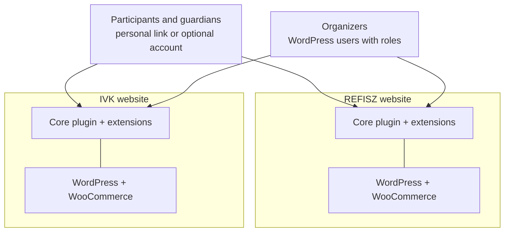

# Overview and principles

These pages are the authoritative record of how Kaláka is built. A change to
the architecture is a pull request that edits them; the owner's merge is the
approval. Git history keeps the earlier sequential decision log.

| Page | Contents |
|---|---|
| [Overview and principles](overview.md) | Purpose, organizations, fixed inputs, guiding principles |
| [Foundation](foundation.md) | Layers, views and grants, the use-case runner, errors, entities, audit, deferred work and evaluation, facts, decisions and computed values, cross-cutting rules |
| [Modules and extensions](modules-and-extensions.md) | Packaging, core modules, assignment sets, extensions in view, schema ownership, identifiers, the extension surface |
| [Events and forms](events-and-forms.md) | Event lifecycle, dates, the registration slot, capacity, prefill, form links, fields, conditions |
| [Registrations and identity](registrations-and-identity.md) | Accounts and presets, submissions, status and waitlist, reference codes, access, attribution |
| [Money](money.md) | Ledger and payers, recording payments, confirmation, withdrawal, congregation share, sponsor and church support, tariff snapshot, materializer, payments, refunds |
| [Mail](mail.md) | Kinds of mail, deliveries, the sender, configuration, content |
| [Engineering](engineering.md) | Platform, repository layout, tooling, code style, tests and CI |
| [Release plan](release-plan.md) | What each release contains, and what gives way first |
| [Deferred](deferred.md) | What is decided later, and when |

## Purpose

Kaláka is event and camp registration for WordPress. It replaces a setup of
several Google spreadsheets, Forms and Apps Script projects used today by two
organizations: **REFISZ** and **Ifjúságépítők (IVK**, ifjusagepitok.com). In
that setup the parallel K/FF column blocks were a data-entry workaround; in
Kaláka events are created dynamically.

**Build, don't buy:** no existing product met at least 3 of 7 hard criteria.
The architecture was planned from first principles; earlier exploratory
analyses serve only as background.

## Fixed inputs

- **Scale:** 500–2,000 registrations per season, kept for many years. Measured
  in 2026: about 200 per organization and season. Target hosting is low-end
  shared hosting: good to 500 registrants, functional to 1,000.
- **Organizations are completely separate.** Two organizations from day one,
  more possible later. One organization-agnostic codebase, one WordPress
  install per organization; no shared people or data, only the plugin code.
  Both deployments must work at the same time, and deployment should be
  automated.
- **The event is the top-level unit.** There is no grouping layer above
  events; seasons are grouped by dates, labels and filters.
- **WordPress + WooCommerce.** Payments already run online through
  WooCommerce (today Stripe via WooPayments on store.refisz.hu); WooCommerce
  stays the payment engine. The goal is smoother payment, not a replacement.
- **Admins are a team with distinct roles,** so permissions are role-based.
- **Platform minimums:** WordPress 7.0, PHP 8.3, MariaDB 10.3 (details in
  [Engineering](engineering.md#platform)).

## Guiding principles

1. **Layered, with strict separations between core and features,** so parts
   can later be published one by one as open source, which is the eventual
   intention.
2. **Lean on WordPress core as much as possible:** its reactive UI, REST API,
   permissions, block editor, Interactivity API, abilities, Site Health,
   privacy tools and `WP_Error`. The plugin need not be portable, so domain
   code may use WordPress wherever that makes sense.
3. **No paywalled key features and no bending around a form plugin.** Forms
   are our own implementation on WordPress's building blocks.
4. **Today's behavior is the default reference.** There is no blanket
   "reproduce the old system first" rule: every deviation is decided
   explicitly and recorded in these pages.
5. **Use cases before systems.** A mechanism is designed from the concrete
   needs it must serve, as the smallest thing that covers them, with no two
   ways to do the same thing.
6. **Per-event cost does not grow with the number of events.** Listing,
   sorting and searching one event's registrations depends only on that
   event's registrations ([Foundation](foundation.md#entities-repositories-and-queries)).
7. **Never build for SQLite.** MariaDB is the target. SQLite (WordPress
   Playground) gets no design attention and no adaptive code; where it
   differs, it is not supported, and we may simply avoid depending on things
   it lacks when that costs nothing.
8. **Hungarian only.** The UI is Hungarian, written directly in the code with
   no translation layer. Internationalization is far off and can be added
   later. Code identifiers and comments are in English.
9. **Nothing reaches the UI unapproved.** UI text and behavior are approved by
   the owner when the UI is built ([Deferred](deferred.md#ui-text-approved-when-built)).

## Context

