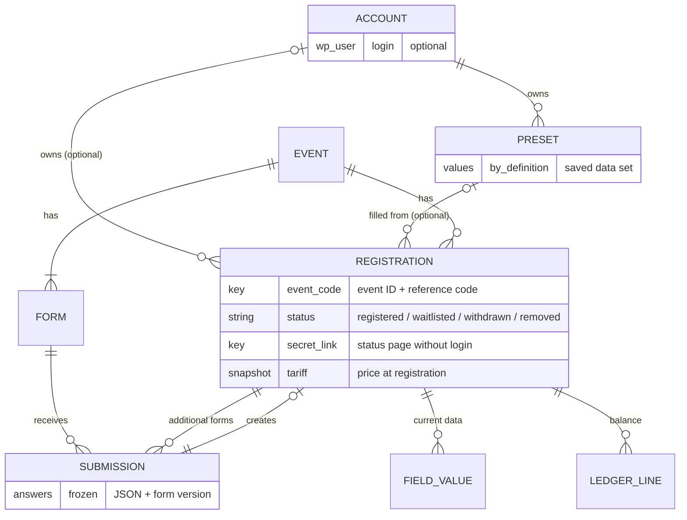

# Registrations and identity

## Registrations

- **A registration is one participant for one event.** Attending two events
  (e.g. both REFISZ camps) means registering twice; the registrations are
  fully separate: own reference code, status, secret link and ledger.
- **A registration's only identity is (event ID, reference code).** There is
  no numeric registration ID. Every per-event table refers to a registration
  by that pair, and **neither part ever changes**. Because InnoDB stores rows
  in primary-key order, each event's registrations sit together on disk.
- Records without a reference code, such as events and presets, keep a normal
  numeric primary key. Where something must point at records of any type, it
  uses record type, event ID and key (as audit subjects do,
  [Foundation](foundation.md#audit)). WooCommerce order-line metadata stores
  the composed form `12:47K3`, composed and parsed only in the payments code.

## Identity: no person records

- **Registration-centric identity.** Each registration holds its own personal
  data; the same real person's data may differ between events. Year-to-year
  tracking is a later, heuristic add-on built from preset links: the system is
  not an outreach CRM.
- **Registration does not require a WordPress account.** Without one, a
  personal secret link opens the registration's status page, including its
  payment status. Guest registration is deliberately semi-anonymous; guests
  are never matched, and organizers get no manual linking tool.
- **An account is an optional extra layer** that **owns** registrations and
  **presets**. It can hold registrations for several people (a guardian, a
  youth leader registering a group), for several events; it sees all
  outstanding balances together and can **pay them at once**
  ([Money](money.md#paying-several-registrations-at-once)).
- **A guest can attach a registration to an account** through its secret link.
  This triggers the same side effects as registering with a new account (e.g.
  creating a preset from that registration).
- **Default flows are seamless:** guest registration, and registration with
  an account created on the form
  ([below](#accounts-on-the-registration-form)). Flows with several
  registrations under one account may ask more of the user, with short
  explanations.

## Accounts on the registration form

- **Creating an account is an opt-in on the registration form,** offered
  only to people aged 16 or over (Hungary's age of digital consent; IVK's
  participants are all adults).
- **The form never asks for a password.** The account is activated through
  a set-password mail sent by the queue, which also verifies the address.
- **If the person is logged in,** the registration attaches to their account.
- **If the email already has an account,** the registration attaches when
  the mail's link is used. The form never reveals whether an account exists.
- At first the portal may show only a "coming soon" page
  ([Release plan](release-plan.md)).

## Presets

- A **preset** is a saved data set, like a webshop's saved addresses. A
  registration records the preset it was filled from.
- **Values are stored by field definition**
  ([Fields](events-and-forms.md#fields)).
- **Saving is the default and can be cancelled.** Creating a new preset (when
  an account is created, or a guest registration is attached) and saving
  changes back to an existing preset both happen by default, each with an
  info box that offers to cancel.
- **Editing a preset never changes existing registrations,** and editing an
  account's profile never changes a registration.
- Privacy export and erase cover presets.

## Submissions and values

- A **submission** is the frozen original: the answers as JSON plus the form
  version, never changed. A view of it comes later, at low priority.
- **A submission creates zero or one registration, never more.** A form in
  the registration slot creates one; an additional form attaches a
  **supplementary submission** to an existing registration. Supplementary
  answers are facts that rules and fee components can read.
- **At submit the answers are copied** into the registration's **field
  values**, which hold the current state and are what admins work with.
- **One row per field,** each carrying the event ID, keyed by event,
  reference code and field. Loading a registration is one index range read;
  filtering and sorting by a field stay within the event. Estimated at about
  a million rows over ten years, which InnoDB handles comfortably.
- Editability after submit: [Fields](events-and-forms.md#editability-after-submit).

## Status, capacity and waitlist

- **Status and the "full" latch are facts,** stored and changed only by
  people's acts, never recomputed
  ([Foundation](foundation.md#facts-decisions-and-computed-values)). Status is
  `registered`, `waitlisted`, `withdrawn` (by the participant) or `removed`
  (by an admin).
- It is **set at registration by capacity**, then changes only by explicit
  acts: withdraw, remove, admit from the waitlist, restore. **A withdrawal
  never automatically admits anyone from the waitlist;** changes to the list
  after it filled up are explicit admin acts.
- **Only capacity (waitlisted) and withdrawal or removal keep a registration
  from being `registered`.** Deposit or aid status never makes a registration
  invalid.
- **Confirmation sits beside status, not in it:** it is defined only for
  `registered` registrations, a system decision recorded from payments or a
  manual flag ([Money](money.md#confirmation)). Participants see one phase
  sequence (waitlisted → awaiting payment → confirmed, or withdrawn /
  removed) through the phase tracker.
- **Withdrawal and removal have the same effect on money:** the event's
  retention rule ([Money](money.md#withdrawal-removal-and-substitution)).
- **One capacity per event.** Every form in the registration slot counts
  toward it, except **"not counted"** registrations (e.g. children under 13
  at the event's own start, who come with a parent).
- **"Not counted" is decided once, at registration,** by the event's
  condition on field values, and stored as a fact; afterwards only staff
  change it, as an audited act. A "not counted" registration bypasses
  capacity and the "full" latch: it is never waitlisted and never sets the
  latch.
- The first counted registration that does not fit sets the event's
  **"full" latch**; from then on new registrations are waitlisted even if a
  place frees up, until an admin explicitly clears the latch (reopens the
  event). Editing the registration dates does not clear it.
- **The capacity check locks the event row** inside the submit transaction.
- **Quota places are held when a registration becomes `registered`**
  ([Money](money.md#quota-places)).
- The **sorszám** (order within `registered`, and within `waitlisted`) is
  derived and renumbers; there is no stored serial.
- A form link can bypass capacity and the latch
  ([Forms](events-and-forms.md#form-links-and-admin-submissions)).

## Reference codes

The **reference code** is the short public identifier: bank-transfer
reference and check-in barcode.

- **Format:** digit, digit, letter, digit. Letters `A K B E G J T Z F L R S X
  I` (indexes 0–13).
- **Validity:** `(9·d1 + 5·d2 + 9·L + 9·d4) mod 14 < 5`, giving **5,000 codes
  per event**. It catches 70% of single wrong characters (the maximum for
  5,000 codes) and 69% of swapped leading digits; swapping a letter and a
  digit always fails the format.
- **Unique per event.** A registration filled from a preset reuses the code
  of that preset's previous registration if it is free; otherwise a random
  code (CSPRNG) is chosen, avoiding codes used in previous events where
  possible. A collision is a retryable error.
- **When an event runs out,** codes are extended by appending digits, and
  admins get a warning. An extended code still never changes.
- No lookalike mapping, no accent folding, no blocked prefixes.
- **The code grants no access.**

## Access

- **Access to a registration** is granted by its **secret link** (that one
  registration) or by being logged in as its **owner account** (all owned
  registrations, plus account-level actions). Organizers and outside
  partners are admin-side users who reach registrations through the views
  granted to them ([Foundation](foundation.md#views-and-grants)).
- **Secret links:** 128 random bits, URL-safe (22 characters). They are
  **stored readable,** so every email can carry the registrant's link. They
  are treated as secrets: never logged, masked in exports.
- **Organizers can regenerate a link:** an audited use case; the old link
  stops working immediately. Mailing the new link is an action mail, switched
  on or off per event like the others.
- **The contact email is not unique.** "Resend my link" mails the links of
  every registration with that address. When a second guest registration with
  the same email is submitted to the same event, the registrant sees a soft
  notice, not a rejection.

## Attribution and erasure

- **The form link a registration came through is stored as a fact**
  ([Forms](events-and-forms.md#form-links-and-admin-submissions)), filterable
  in views.
- **A hidden attribution field** can carry a key from another page, e.g. the
  module recommender's answers. Erasing the registration deletes the field
  value, so those answers stay, unlinked and anonymous, for statistics.
- **An erasure anonymises** the registration's personal fields and answers.
  The reference code, ledger lines and decision records are kept. **Ledger
  lines are kept at least 8 years** (the Hungarian accounting-law period), to
  be confirmed with the organisations' bookkeepers.
- Erasure and the other GDPR self-service features are nice to have at launch
  and may come later ([Release plan](release-plan.md)).
